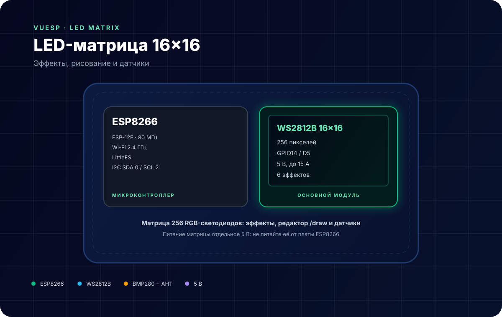
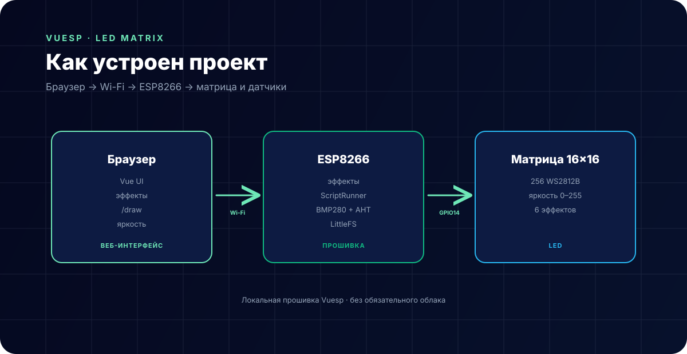

# LED-матрица 16×16 — эффекты и рисование



**Коротко:** `vuesp.led-matrix` — прошивка Vuesp для матрицы **256 WS2812B (16×16)** на ESP8266. Есть шесть эффектов, визуальный редактор `/draw`, кнопка переключения эффектов и датчики BMP280 + AHT10/20.

## Что это за устройство

Устройство собирается из трёх частей:

- **ESP8266 (ESP-12E / Wemos D1 mini)** — Wi-Fi и веб-интерфейс;
- **матрица 16×16 на WS2812B** — 256 адресуемых RGB-светодиодов;
- **датчики BMP280 и AHT10/20** на общей I2C-шине.

Прошивка умеет:

- рисовать картинку из редактора `/draw` (256 пикселей);
- проигрывать эффекты: огоньки, огонь, радуга, мерцающие звёзды, бегущий огонь;
- менять яркость и скорость;
- переключать эффект физической кнопкой;
- отдавать температуру, влажность, давление и высоту.

## Характеристики

| Параметр | Значение |
| --- | --- |
| Микроконтроллер | ESP8266 (ESP-12E, 80 МГц) |
| Матрица | WS2812B, 16×16, 256 пикселей |
| Линия данных | GPIO14 (D5) |
| Яркость | 0–255, по умолчанию 10 |
| Скорость эффектов | мс на кадр, по умолчанию 60 |
| I2C | SDA GPIO0 (D3), SCL GPIO2 (D4) |
| Кнопка | GPIO13 (D7) |
| Датчик присутствия | GPIO12 (D6), HLK-LD101 |
| Питание матрицы | 5 В, отдельный блок |
| Среда | PlatformIO + Arduino |

## Распиновка

| Сигнал | GPIO | Пин NodeMCU | Примечание |
| --- | --- | --- | --- |
| DATA матрицы | 14 | D5 | DIN первого светодиода |
| SDA | 0 | D3 | BMP280 + AHT |
| SCL | 2 | D4 | BMP280 + AHT |
| Кнопка | 13 | D7 | на GND, `INPUT_PULLUP` |
| Датчик HLK-LD101 | 12 | D6 | цифровой выход |
| Питание логики | — | 3V3 | от USB или стабилизатора |

В прошивке (`src/include/led.h`, `src/device/device.h`):

```cpp
#define GPIO_LED 14
#define GPIO_SDA 0
#define GPIO_SCL 2
#define GPIO_BTN 13
#define GPIO_HLK_LD101 12
#define NUMPIXELS 256
```

## Схема подключения

| Цепь | Подключение |
| --- | --- |
| Матрица 5V | +5 В блока питания |
| Матрица GND | GND блока **и** GND ESP8266 |
| Матрица DIN | GPIO14 (D5), желательно через level shifter 3.3 → 5 В |
| Матрица DOUT | не используется |
| BMP280 / AHT | VCC 3.3 В, GND, SDA GPIO0, SCL GPIO2 |
| Кнопка | GPIO13 ↔ GND |

> **Важно.**
> - Не питайте матрицу от платы ESP8266: при полной яркости 256 пикселей потребляют до **15 А** (60 мА на пиксель). Берите блок 5 В ≥ 10 А и добавляйте конденсатор 1000 мкФ на вход матрицы.
> - Уровень данных WS2812B — 5 В. При 3.3 В матрица может работать нестабильно; надёжнее поставить level shifter (74HCT245) или буфер.
> - GPIO0 и GPIO2 — strapping-пины. I2C-подтяжки держат их высоко, поэтому загрузка проходит, но не вешайте на эти линии ничего лишнего.

## Эффекты

| Код | Эффект | Описание |
| --- | --- | --- |
| `0` | Draw | статичная картинка из редактора |
| `1` | Lighters | плавающие цветные огоньки |
| `2` | Fire | имитация пламени |
| `3` | Rainbow | переливающаяся радуга |
| `4` | Twinkling stars | мерцающие звёзды |
| `5` | Chase | бегущий огонь |

Кнопка на GPIO13 переключает эффект по кругу; последний возвращается к `Draw`.

## Редактор `/draw`

Страница `/draw/` открывает визуальный редактор:

- сетка 16×16;
- выбор цвета;
- отправка кадра в устройство;
- сохранение картинки в LittleFS (`Draw` → `src/const/struct.h`).

Кадр передаётся как массив `uint32_t buffer[256]`, упакованный как `R << 24 | G << 16 | B << 8`.

## Датчики

Раз в 10 секунд читаются:

| Датчик | Поля |
| --- | --- |
| BMP280 | температура, давление, высота (расчёт по 1013.25 гПа) |
| AHT10/20 | температура, влажность |

Данные отправляются отдельной структурой `Sensors` по WebSocket. Если датчик не отвечает, `sensors.status` содержит ошибку, а поля остаются нулями.

## Как устроен проект



- `src/led.cpp` — драйвер матрицы и эффекты;
- `src/device/device.cpp` — устройства, кнопка, датчики, команды;
- `src/const/struct.h` — `Device`, `Draw`, `Sensors`;
- `vue/src/pages/draw.vue` — редактор;
- `vue/` — веб-интерфейс Vuesp.

## ScriptRunner

| Функция | Назначение |
| --- | --- |
| `http(method, url, count, num, data)` | заготовка HTTP-запроса |
| `$display` | строковый буфер для сценариев |

Пример смены яркости:

```text
log('matrix ready');
```

## Сборка и прошивка

```bash
cd vue
npm ci
npm run build-web

cd ..
~/.platformio/penv/bin/pio run -e esp8266
~/.platformio/penv/bin/pio run -e esp8266 -t buildfs
```

Прошивка: `build/esp8266/firmware.bin`, FS: `build/esp8266/littlefs.bin`.

## Ограничения

- Матрица строго 16×16 и 256 пикселей; другой размер потребует правки `WIDTH`, `HEIGHT`, `NUMPIXELS` и редактора.
- ESP8266 обновляет 256 пикселей по одному проводу — при большой яркости и сложных эффектах возможны подтормаживания Wi-Fi.
- Питание матрицы отдельное; общий GND обязателен.
- I2C на GPIO0/GPIO2 — strapping-пины: при неисправной подтяжке плата может не загрузиться.
- BMP280 и AHT10/20 имеют фиксированные адреса; два одинаковых датчика на одной шине не заработают без мультиплексора.
- Датчик HLK-LD101 читается как цифровой вход, без обработки дистанции.

## Источники

- [Adafruit NeoPixel — библиотека и питание](https://learn.adafruit.com/adafruit-neopixel-uberguide)
- [WS2812B datasheet](https://cdn-shop.adafruit.com/datasheets/WS2812B.pdf)
- [BMP280 datasheet](https://www.bosch-sensortec.com/products/environmental-sensors/pressure-sensors/bmp280/)
- [AHT10 datasheet](https://www.aosong.com/en/products-22.html)
- [Документация Vuesp](https://docs.vuesp.ru)
